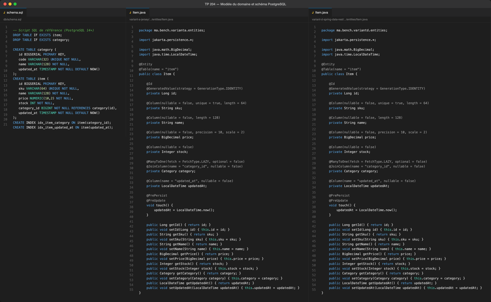
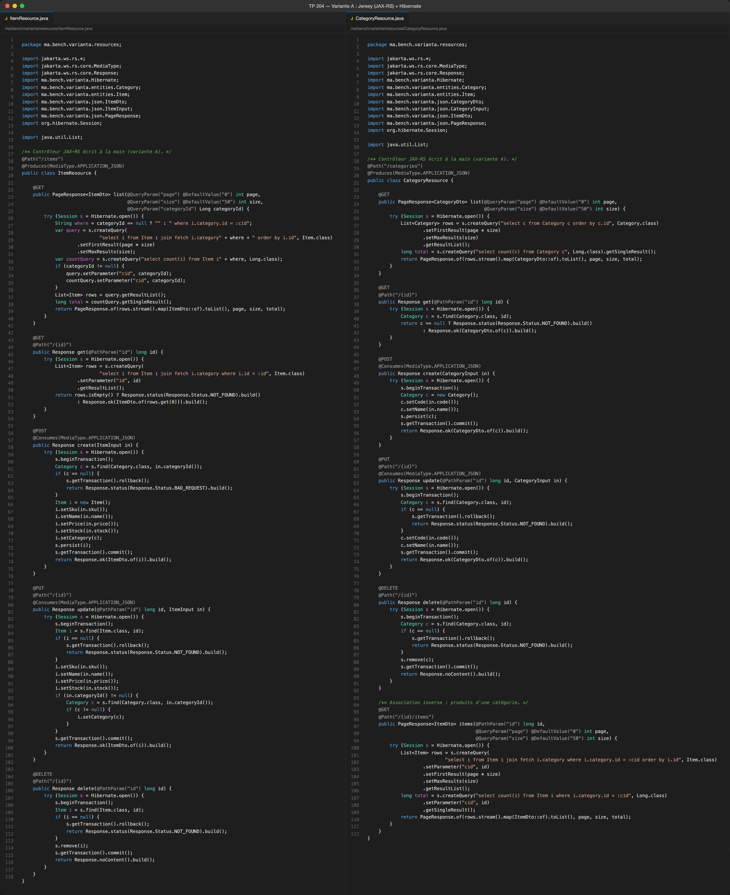
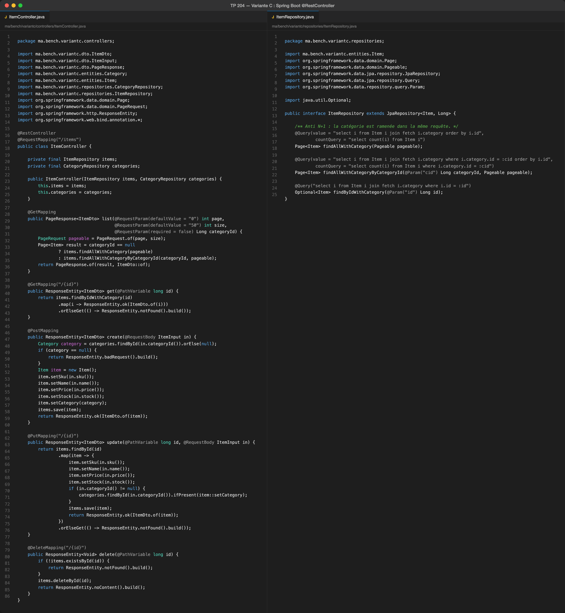
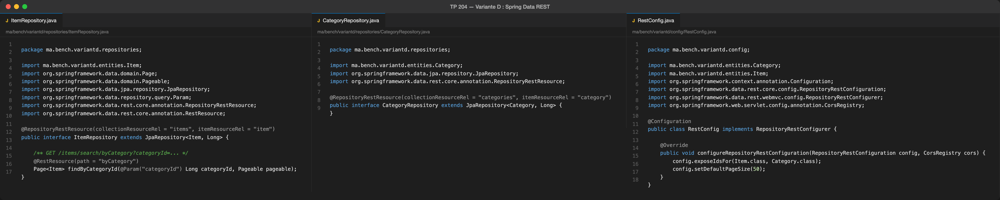
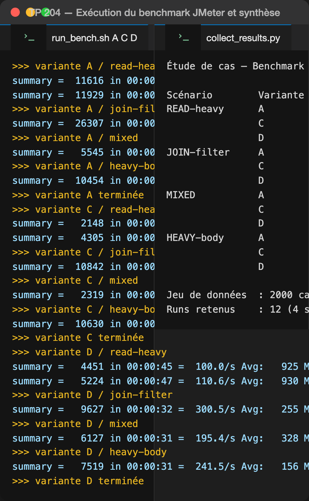

# Étude de cas : Benchmark de performances des Web Services REST

Comparaison de trois expositions REST du même domaine `Category` / `Item` — **A** Jersey (JAX-RS) + Hibernate, **C** Spring Boot `@RestController`, **D** Spring Data REST — sur une base PostgreSQL de 2 000 catégories et 100 000 items. Les quatre scénarios JMeter du TP (READ-heavy, JOIN-filter, MIXED, HEAVY-body) ont été rejoués sur les trois variantes ; les tableaux T0→T7, l'analyse et les recommandations sont dans [report/RAPPORT.md](report/RAPPORT.md).

## 1. Modèle du domaine et schéma PostgreSQL

Le schéma de référence du TP (tables `category` et `item`, index `idx_item_category` et `idx_item_updated_at`) et les entités JPA correspondantes, communes aux trois variantes.

## 2. Variante A — Jersey (JAX-RS) + Hibernate

Contrôleurs JAX-RS écrits à la main, sessions Hibernate explicites et requêtes HQL avec `join fetch` pour éviter le N+1.

## 3. Variante C — Spring Boot @RestController

Mêmes endpoints exposés par des contrôleurs Spring MVC et des repositories Spring Data JPA, avec projections DTO.

## 4. Variante D — Spring Data REST

Aucun contrôleur : les repositories exposent `/items` et `/categories`, la recherche `byCategory` passe par `@RestResource`, et `RestConfig` active `exposeIdsFor`.

## 5. Exécution des scénarios JMeter et résultats

Exécution des quatre scénarios sur les trois variantes (base réinitialisée entre chaque variante) et synthèse des débits, latences p50/p95/p99 et taux d'erreur.

